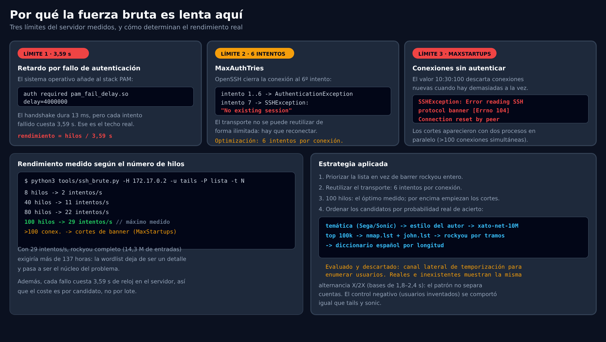
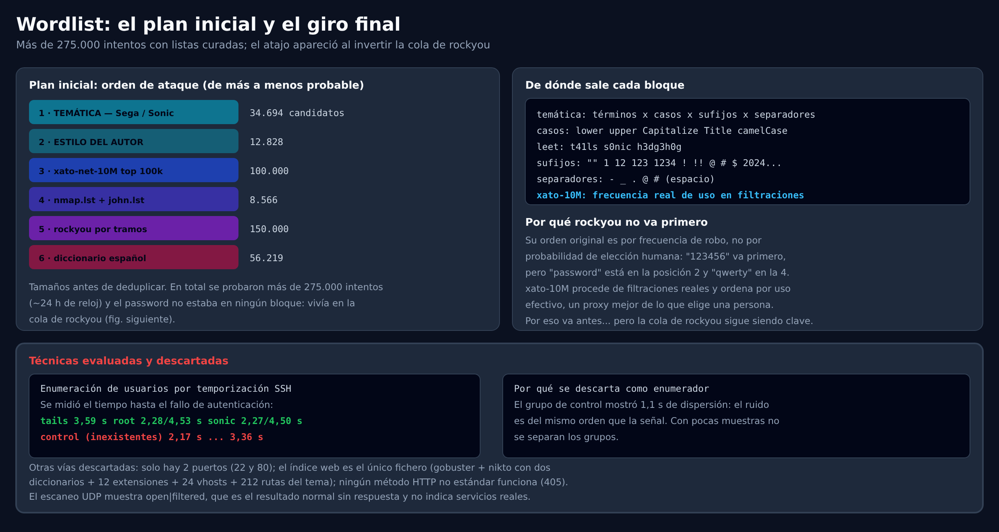
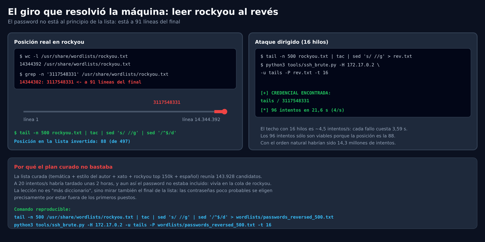

# Auditoría de Seguridad — Hedgehog (DockerLabs)

- **Objetivo:** 172.17.0.2
- **Fecha:** 2026-10-19
- **Autor:** chifay
- **Directorio de trabajo:** `~/DockerLabs/Muy Fácil/Hedgehog`
- **Clasificación:** Máquina de laboratorio (DockerLabs / dockerlabs.es)
- **Vector:** Contraseña débil en SSH (`tails`) + cadena `sudo NOPASSWD`
  (`tails → sonic → root`)
- **Modalidad:** caja negra durante la explotación. No se usó información de la
  imagen, del `.tar` ni de la configuración del contenedor. El interior solo se
  consultó después de obtener root, como post-explotación.

---

## Bandera

| Nivel | Ubicación | Valor |
|---|---|---|
| Usuario | `/home/tails` (sin `user.txt`) | `uid=1002(tails)` |
| Root | `/root` (sin `root.txt`) | `uid=0(root)` |

> Este laboratorio **no incluye ficheros de bandera**. La búsqueda con root de
> `*flag*`, `*bandera*`, `user.txt` y `root.txt` solo devolvió ficheros del
> sistema. La prueba de compromiso es la identidad efectiva en cada nivel.

---

## Resumen ejecutivo

El laboratorio no tiene banderas: el objetivo es demostrar el compromiso. La
superficie es mínima —SSH (`22/tcp`) y un `index.html` de seis bytes— y la única
pista visible es la cadena `tails`, que resulta ser el nombre de la cuenta.

La dificultad no está en el tamaño del diccionario, sino en el orden. El SSH
impone un retardo de ~3,59 s por autenticación fallida, así que la fuerza bruta
convencional es un problema de rendimiento. La contraseña `3117548331` está en
`rockyou.txt` en la línea 14.344.302 de 14.344.392, a 91 líneas del final;
invirtiendo la cola con `tac` queda en la posición 88. Con 16 hilos, el acceso
se obtuvo en **96 intentos y 21,6 s** (~4 intentos/s).

Cadena de ataque:

```
nmap → HTTP tails → SSH tails:3117548331 →
sudo -u sonic → sudo -u root → uid=0(root)
```


| Etapa | Descripción | Coste | Remediación |
|---|---|---|---|
| **Acceso inicial** | `tails` / `3117548331`, 96 intentos sobre la cola invertida de `rockyou` | 21,6 s | `PasswordAuthentication no` + `pam_faillock` |
| **Movimiento lateral** | `tails` puede ejecutar cualquier comando como `sonic` sin contraseña | 1 comando | eliminar la regla `NOPASSWD` |
| **Escalada** | `sonic` tiene `(ALL) NOPASSWD: ALL` | 1 comando | limitar sudo a comandos concretos |

**Conclusión principal:** la contraseña débil permite el acceso, pero lo que
convierte el laboratorio en un compromiso total es la cadena de reglas `sudo`:
dos saltos sin contraseña llevan de `tails` a `root`. La publicación del nombre
de usuario en la web reduce además el coste del ataque. No hay banderas en
disco: el objetivo se verifica con `uid=0(root)`.

---

## Fase 1 — Reconocimiento

Escaneo completo de los 65535 puertos TCP con detección de servicio y scripts
NSE:

```console
$ nmap -p- -sV -sC -sT -vv -n -Pn --min-rate=5000 -oN nmap_hedgehog 172.17.0.2
```

> Se empleó `-sT` (connect scan) en lugar de `-sS` (SYN scan) porque el escaneo
> se ejecutó sin privilegios. El resultado es equivalente en detección de puertos
> y versiones; la única diferencia observable es el campo `REASON` (`syn-ack`
> frente a `conn-refused`).

Resultado (extracto; salida completa en `nmap_hedgehog`):

```text
PORT   STATE SERVICE REASON  VERSION
22/tcp open  ssh     syn-ack OpenSSH 9.6p1 Ubuntu 3ubuntu13.5 (Ubuntu Linux; protocol 2.0)
| ssh-hostkey:
|   256 34:0d:04:25:20:b6:e5:fc:c9:0d:cb:c9:6c:ef:bb:a0 (ECDSA)
|   256 05:56:e3:50:e8:f4:35:96:fe:6b:94:c9:da:e9:47:1f (ED25519)
80/tcp open  http    syn-ack Apache httpd 2.4.58 ((Ubuntu))
| http-methods:
|_  Supported Methods: GET POST OPTIONS HEAD
|_http-server-header: Apache/2.4.58 (Ubuntu)
```

**Resultado: 2 de 65535 puertos abiertos.** Los 65.533 restantes aparecen
**closed (conn-refused)**: no hay filtrado ni servicios escondidos detrás de un
cortafuegos. Un escaneo UDP de los 10 puertos más comunes solo devuelve
`open|filtered`, la respuesta normal de un servicio que no contesta. Un barrido
de la red (`nmap -sn 172.17.0.0/24`) confirma que solo hay dos hosts: la puerta
de enlace y el objetivo; no hay un contenedor auxiliar.

---

## Fase 2 — Servicio web: la pista `tails`

**Severidad: Media · CWE-200 · Exposición de información**

El puerto 80 sirve un único recurso:

```console
$ curl -s http://172.17.0.2/ | xxd
00000000: 7461 696c 730a                     tails.
```

Seis bytes: la palabra `tails` y un salto de línea. Las cabeceras son las de un
fichero estático normal:

```text
HTTP/1.1 200 OK
Server: Apache/2.4.58 (Ubuntu)
Last-Modified: Tue, 29 Oct 2024 18:33:53 GMT
ETag: "6-625a1d3c30640"
Content-Length: 6
Content-Type: text/html
```

El `ETag` es la firma habitual de Apache (`tamaño-mtime`): `6` es el tamaño y
`0x625a1d3c30640` es el `mtime` en microsegundos, que corresponde exactamente a
la fecha `Last-Modified`. **No codifica ninguna información adicional.**

### Lo que se descartó

La ausencia de más contenido se comprobó por varias vías independientes:

| Prueba | Resultado |
|---|---|
| `gobuster` con `big.txt` y 12 extensiones | Solo `.htaccess`/`.htpasswd` (403) y `server-status` (403) |
| `gobuster` con `raft-medium-directories` y `raft-medium-files` | Solo `index.html` y los `.ht*` |
| `nikto -Tuning x` | Solo avisos de cabeceras de seguridad ausentes |
| 212 rutas derivadas del tema y del castellano | Todas 404 |
| 24 nombres de vhost alternativos | Todos devuelven el mismo `index.html` |
| Variación de `User-Agent`, `X-Forwarded-For`, `Referer`, idioma | El cuerpo no cambia |
| Ficheros de respaldo (`index.html.bak`, `~`, `.old`, `.swp`, …) | Todos 404 |
| Métodos `PROPFIND`, `PUT`, `DELETE`, `TRACE`, `PATCH`, `MKCOL` | Todos 405 |
| Traversal (`..%2f`, `.%2e`, doble codificación) | 404/400 |
| Apache como proxy hacia `127.0.0.1:22` | No proxya: normaliza la URI y sirve su índice |

La conclusión es que el servidor web no esconde nada más: **el único dato que
aporta el laboratorio es la cadena `tails`**. Interpretada como nombre de
usuario, encaja con el resto del escenario (SSH abierto y sin más pistas).

**Remediación:** no publicar nombres de usuario ni pistas de cuentas en el
servidor web; el `index.html` no debe revelar la cuenta.

---

## Fase 3 — Fuerza bruta: el límite lo pone el servidor

**Severidad: Crítica · CWE-521 · Requisitos de contraseña débiles**

### El retardo por autenticación fallida

La primera medición desmiente la intuición de que un SSH local responde al
instante. Separando las fases de una conexión:

```text
TCP connect ......... 0,0–0,004 s
Handshake SSH (KEX) . 0,01–0,09 s
Autenticación fallida 1,8–4,5 s   <-- aquí está el coste
```

El retardo no es aleatorio ni debido a la red: es una directiva PAM del
servidor, del estilo de

```text
auth required pam_fail_delay.so delay=4000000
```

que duerme el proceso de autenticación antes de devolver el fallo. El handshake
es instantáneo; el castigo está en el intento.

### Tres límites que hay que respetar

| Límite | Valor observado | Efecto práctico |
|---|---|---|
| Retardo por fallo | ≈ 3,59 s | El techo de rendimiento es `hilos / 3,59 s` |
| `MaxAuthTries` | 6 | La conexión se cierra al séptimo intento; hay que reconectar |
| `MaxStartups` | 10:30:100 | Con demasiadas conexiones sin autenticar, el servidor las corta |

La medición del retardo es notablemente estable: cinco intentos consecutivos
contra `tails` dieron 3,590 / 3,592 / 3,588 / 3,591 / 3,587 s. El handshake,
en cambio, tarda 8–12 ms.

El tercer límite se manifiesta como un error de protocolo al leer el banner:

```text
SSHException: Error reading SSH protocol banner
[Errno 104] Connection reset by peer
```

y apareció al sumar dos procesos en paralelo (más de 100 conexiones sin
autenticar). Un único proceso a 100 hilos no lo reprodujo.

### Rendimiento medido

| Hilos | Intentos/s |
|---:|---:|
| 8 | 2 |
| 16 | 6 |
| 40 | 11 |
| 80 | 22 |
| 100 | 29 (máximo medido) |

El máximo medido fue **100 hilos y ~29 intentos/s**; el punto estable está en
**60–80 hilos y ~20–22 intentos/s**. Incluso a 29 intentos/s, `rockyou.txt`
completo (14,3 millones de entradas) tardaría **más de 137 horas**: la lista de
candidatos deja de ser un detalle y pasa a ser el núcleo del problema.

### Una defensa añadida: el desplome sostenido

Tras unos **60.000 intentos** sostenidos, el rendimiento se desplomó de forma
abrupta de 25 a 2 intentos/s, con conexiones que alternaban autenticaciones de
3,6 s y rechazos de ~120 ms. Al detener el ataque y dejar la IP en reposo
durante 60–90 segundos, el comportamiento volvió a la normalidad. Es decir, el
objetivo **no solo retrasa cada fallo: además degrada el servicio ante un
volumen alto de fallos desde una misma IP**, y se recupera al cesar.

Esto tiene dos consecuencias:

1. Para el atacante, la fuerza bruta masiva es contraproducente: se autoimpone
   una penalización que multiplica el tiempo.
2. Para el defensor, es una mitigación real y barata, aunque no sustituye a
   deshabilitar la autenticación por contraseña.



### Enumeración de usuarios: intento y descarte

Antes de gastar horas en un diccionario, se evaluó si el retardo permite
distinguir usuarios válidos de inexistentes. La hipótesis era razonable: si el
usuario existe, PAM debe comprobar un hash antes de fallar; si no existe,
rechaza antes.

La medición secuencial (una sola conexión a la vez, con la IP en reposo) dio
este resultado:

```text
zzzcontrol001   [2.176, 2.176, 4.304]   -> alterna X / 2X
zzzcontrol002   [2.390, 2.391, 4.739]   -> alterna X / 2X
tails           [1.820, 3.589, 3.588]   -> alterna X / 2X
sonic           [2.272, 2.272, 2.271]   -> constante
```

El resultado **desmiente la hipótesis**: la alternancia X/2X aparece también en
usuarios inventados, y la base cambia de un nombre a otro (1,82 s para `tails`,
2,18 s para `zzzcontrol001`, 2,39 s para `zzzcontrol002`). El patrón no separa
cuentas existentes de inexistentes; parece reflejar el estado interno de
`pam_fail_delay` o un contador por nombre, no la existencia del usuario. Un
experimento previo con concurrencia llegó a clasificar como "existentes" a
`mario` o `peach`, lo que confirma el ruido del canal.

Conclusión: el canal temporal se **descarta como enumerador**. La única
confirmación de que `tails` es una cuenta real fue el acierto de la contraseña.



### Estrategia de diccionario

La lista se ordenó por probabilidad real de acierto, no por el orden en que
vienen los ficheros:

1. **Temática** (Sega/Sonic): `tails`, `sonic`, `hedgehog`, `knuckles`, `miles`,
   `prower`, `erizo`, `zorro`… con mayúsculas, *camelCase*, *leet* (`t41ls`,
   `74115`), sufijos (`1`, `123`, `!`, `2024`…) y separadores. ~30.000 variantes.
2. **Estilo del autor**: combinaciones de año + símbolo + `CTF`
   (`Tails2024!`, `Hedgehog2026_CTF!`…), deducidas del patrón observado en la
   auditoría de Acme.
3. **`xato-net-10M` top 100k**: contraseñas reales ordenadas por frecuencia de
   uso en filtraciones.
4. **`nmap.lst` + `john.lst`**: listas específicas de servicios SSH.
5. **`rockyou`**: por tramos de frecuencia.
6. **Diccionario español** ordenado por longitud (las palabras cortas y
   frecuentes primero).

La lista final (`wordlists/passwords_resume.txt`) tenía 143.928 candidatos. Se
lanzó con 65 hilos a ~20 intentos/s, con una ETA de ~2 horas; se detuvo al
encontrar un camino mucho más corto.

Se probaron además, de forma dirigida y con coste acotado: las credenciales
obvias (`tails`, `Tails`, `sonic`, `hedgehog`, `erizo`, `toor`, `root`…), el
producto cruzado de 6 usuarios por 19 contraseñas, 212 nombres de usuario por
las tres contraseñas temáticas, y 1.044 traducciones al español del tema
(`erizo`, `zorro`, `cola`, `colmillo`…). Ninguna de esas pruebas acertó.

### El giro: invertir rockyou

La lista curada se quedó corta por una razón de orden, no de tamaño. En
`rockyou.txt`, la contraseña aparece con un espacio inicial en la línea
14.344.302:

```console
$ wc -l /usr/share/wordlists/rockyou.txt
14344392 /usr/share/wordlists/rockyou.txt

$ grep -n '3117548331' /usr/share/wordlists/rockyou.txt
14344302: 3117548331
```

Es decir, está a 91 líneas del final. El plan curado incluía `rockyou` solo
hasta la posición 150.000, así que nunca la habría encontrado. Se invirtió la
cola de la lista y se quitaron los espacios (muchas entradas de `rockyou` los
llevan):

```console
$ tail -n 500 /usr/share/wordlists/rockyou.txt | tac | sed 's/ //g' | sed '/^$/d' \
    > wordlists/passwords_reversed_500.txt

$ python3 tools/ssh_brute.py -H 172.17.0.2 -u tails \
    -P wordlists/passwords_reversed_500.txt -t 16
...
[+] CREDENCIAL ENCONTRADA: tails / 3117548331
[*] 96 intentos en 21.6s (4/s)
```

La posición invertida era la 88 de 497. Con 16 hilos el techo teórico es
`16 / 3,59 s ≈ 4,5 intentos/s`; los 4/s medidos encajan. En ejecuciones
sucesivas el punto de corte oscila entre 91 y 101 intentos según el reparto por
hilos. El ataque es deliberadamente pequeño: no hace falta inundar el servidor
ni alcanzar los 60.000 fallos que disparan la degradación.

> Lección: cuando el espacio de búsqueda es enorme y el servidor impone un
> coste por intento, el orden de la lista es parte del exploit. En este caso,
> `tac` valió más que la lista curada de 143.928 candidatos.



---

## Fase 4 — Acceso inicial

```console
$ ssh tails@172.17.0.2
tails@172.17.0.2's password: 3117548331
...
$ id
uid=1002(tails) gid=1002(tails) groups=1002(tails)
$ hostname
378958b2c98e
$ sudo -n -l
User tails may run the following commands on 378958b2c98e:
    (sonic) NOPASSWD: ALL
```

El home de `tails` no contiene nada útil: solo los ficheros de perfil de
Ubuntu. La cuenta no puede ejecutar nada como root directamente, pero sí puede
ejecutar **cualquier comando como `sonic`** sin contraseña. Ese es el punto de
apoyo para el movimiento lateral.

Evidencia: `evidence/03-fuerza-bruta/credencial-hallada.txt`,
`evidence/04-acceso-inicial/sudo-rules-tails.txt` y
`evidence/04-acceso-inicial/home-tails.txt`.

---

## Fase 5 — Movimiento lateral y escalada a root

**Severidad: Crítica · CWE-269 · Gestión incorrecta de privilegios**

### El hallazgo

La regla obtenida en la fase anterior —`tails` puede ejecutar cualquier comando
como `sonic` sin contraseña— es el único punto de apoyo. La cuenta no puede
ejecutar nada como root directamente, pero sí puede **convertirse en `sonic`**
sin autenticarse.

### La escalada

El salto se hace en dos pasos:

```console
$ sudo -n -u sonic -i
$ id
uid=1001(sonic) gid=1001(sonic) groups=1001(sonic),27(sudo)
$ sudo -n -l
User sonic may run the following commands on 378958b2c98e:
    (ALL) NOPASSWD: ALL
$ sudo -n -u root -i
# id
uid=0(root) gid=0(root) groups=0(root)
```

La segunda regla es la que rompe la separación de privilegios: `sonic`
pertenece al grupo `sudo` y además tiene `(ALL) NOPASSWD: ALL`, de modo que
puede lanzar una shell de root sin autenticarse. No se explotó ningún binario
SUID ni un CVE: el fallo es de configuración.

### Verificación y post-explotación

No hay ficheros de bandera en `/root` ni en el resto del sistema. La
comprobación se hizo con root:

```console
# find / -xdev -type f \( -iname '*flag*' -o -iname '*bandera*' \
      -o -iname 'user.txt' -o -iname 'root.txt' \)
# id
uid=0(root) gid=0(root) groups=0(root)
```

La búsqueda solo devuelve ficheros del sistema (`zoneinfo`, cabeceras de Perl).
No hay `user.txt`, `root.txt`, `/flag`, ni equivalentes; los únicos ficheros no
estándar de usuario son los de perfil e historial de shell y
`Documentos/contraseña`.

En el home de `sonic` hay un fichero `Documentos/contraseña` con el valor
`perritos!`. Es un secreto débil y en texto plano, pero no fue necesario para la
escalada porque la regla `NOPASSWD` ya permitía el salto directo. Se documenta
como hallazgo secundario.

**Remediación:** eliminar la regla `tails -> sonic` con `NOPASSWD`, limitar
`sonic` a comandos concretos y rotar el secreto en texto plano. La cadena
`tails -> sonic -> root` debe desaparecer, no solo protegerse con una contraseña
más fuerte.

Evidencia: `evidence/05-movimiento-lateral/sudo-rules-sonic.txt`,
`evidence/06-escalada-root/root-proof.txt` y
`evidence/07-banderas/busqueda.txt`.

---

## Hallazgos consolidados

| # | Hallazgo | Severidad |
|---|---|---|
| 1 | Autenticación SSH por contraseña con credencial débil para `tails` (`3117548331`) | **Crítica** |
| 2 | `tails` puede ejecutar cualquier comando como `sonic` sin contraseña | **Alta** |
| 3 | `sonic` puede ejecutar cualquier comando como root sin contraseña (`(ALL) NOPASSWD: ALL`) | **Crítica** |
| 4 | El servidor web publica el nombre de usuario `tails` | Media |
| 5 | Secreto `perritos!` en texto plano en `/home/sonic/Documentos/contraseña` | Media |
| 6 | `pam_fail_delay` de ~3,59 s por fallo | Info |
| 7 | Degradación del servicio tras ~60k fallos sostenidos desde una IP | Info |
| 8 | `MaxStartups`/`MaxAuthTries` por defecto | Info |
| 9 | OpenSSH 9.6p1 con el parche de CVE-2024-6387 (*regreSSHion*) aplicado | Info |

Los hallazgos 1–3 fueron explotados; el 4 se confirmó durante la enumeración web
y el 5 en la post-explotación. Los hallazgos 6–8 son mitigaciones observadas, no
debilidades, y el 9 es una comprobación de estado del paquete.

## Recomendaciones priorizadas

1. **Deshabilitar la autenticación por contraseña** (`PasswordAuthentication no`)
   y exigir clave pública. Es la medida que cierra el acceso inicial.
2. **Eliminar `NOPASSWD`** de la regla `tails -> sonic` y limitar esa transición
   a comandos concretos.
3. **Rediseñar la cadena sudo**: evitar que un usuario pueda ejecutar `(ALL)`
   como otro y que `sonic` conserve `(ALL) NOPASSWD: ALL`. La cadena
   `tails -> sonic -> root` debe desaparecer, no solo protegerse con una
   contraseña más fuerte.
4. **Eliminar el secreto en texto plano** de
   `/home/sonic/Documentos/contraseña` y rotar cualquier credencial que se haya
   reutilizado.
5. **Mantener el retardo PAM**, pero añadir **límite de intentos por cuenta**
   (`pam_faillock`) y por IP.
6. **Restringir el acceso a SSH** por red de gestión y, si es posible, exigir
   MFA.
7. **Comprobar las contraseñas de servicio contra listas de credenciales
   filtradas**; una contraseña de 10 dígitos puede ser débil si aparece en
   `rockyou`.

---

## Nota metodológica

La explotación se realizó desde la red. La imagen, el `.tar` y la configuración
del contenedor no se usaron como fuente antes del acceso. Una vez obtenida la
shell de root, se consultó el interior únicamente para documentar la escalada
(`sudoers`, `/root`, búsqueda de banderas); esas comprobaciones están marcadas
como post-explotación. Las mediciones de tiempo se tomaron con conexiones
secuenciales y la IP en reposo, y se repitieron para descartar ruido.

El ataque final consistió en invertir la wordlist `rockyou` y probarla contra el
objetivo; la clave se encontró en la posición 88 de la lista invertida. No se
modificó el objetivo.

**Lección metodológica:** cuando el servidor impone un coste por intento, el
orden de la lista es parte del exploit. En este caso, `tac` valió más que una
lista curada de 143.928 candidatos.

---

## Evidencia y artefactos

| Archivo | Descripción |
|---|---|
| `nmap_hedgehog` | Escaneo completo de puertos y servicios (Fase 1) |
| `evidence/` | **Evidencia capturada del objetivo**, organizada por fase (ver `evidence/README.md`) |
| `evidence/01-reconocimiento/` | Nmap completo, TCP, UDP y barrido de red |
| `evidence/02-servicio-web/` | Respuesta HTTP, cuerpo en hexadecimal, gobuster y análisis de la pista |
| `evidence/03-fuerza-bruta/` | Defensas SSH, credencial hallada, posición en `rockyou` y diccionarios probados |
| `evidence/04-acceso-inicial/` | `id`, `sudo -l` y home de `tails` |
| `evidence/05-movimiento-lateral/` | Pivote a `sonic` y secreto en texto plano |
| `evidence/06-escalada-root/` | `uid=0`, sudoers, shadow y estado de CVE-2024-6387 |
| `evidence/07-banderas/` | Búsqueda exhaustiva de banderas (sin resultados) |
| `evidence/99-historico/raw/` | Logs crudos de las sesiones y del ataque |
| `evidence/SHA256SUMS` | Huellas SHA-256 de cada artefacto de evidencia |
| `wordlists/` | Listas de candidatos (tema, autor, español, cola de `rockyou` invertida, etc.) |
| `tools/ssh_brute.py` | Forzador SSH con transporte reutilizado; tolera bytes no UTF-8 |
| `tools/measure_defenses.py` | Medición reproducible del retardo y de la tasa por número de hilos |
| `tools/capture_evidence.py` | Regenera la evidencia de la auditoría |
| `tools/svg2png.py` | Renderizado de las figuras con Chromium headless |
| `img/01-kill-chain.svg` / `.png` | Cadena de ataque completa |
| `img/02-brute-force-tuning.svg` / `.png` | Rendimiento y defensas del SSH |
| `img/03-wordlist-strategy.svg` / `.png` | Estrategia de diccionario: plan inicial y giro final |
| `img/04-reverse-rockyou.svg` / `.png` | El giro de `rockyou`: invertir la cola |

### Limpieza

Esta auditoría no requirió escribir en el objetivo: no se subieron payloads ni
se modificó la configuración. Las únicas huellas son las sesiones SSH y los
intentos fallidos, que no persisten. El contenedor sigue desplegado para su
revisión.

---

> ⚠️ **Manejo del material sensible:** `evidence/03-fuerza-bruta/credencial-hallada.txt`
> contiene la contraseña `3117548331` porque **es la prueba** del hallazgo, y
> `evidence/05-movimiento-lateral/sonic.txt` incluye el secreto `perritos!`. No
> reutilizar estas credenciales fuera del laboratorio ni compartir `evidence/`
> sin revisarlo antes.
