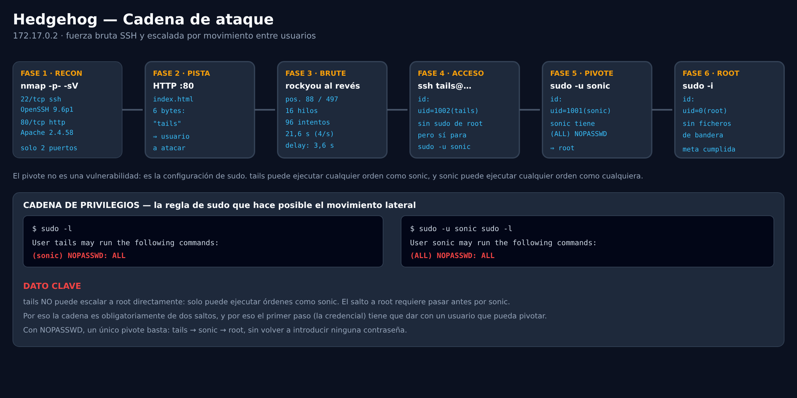

<div align="center">

# Auditoría de Seguridad — Hedgehog

**Máquina DockerLabs · objetivo `172.17.0.2`**

Sin banderas · acceso por contraseña débil · escalada por cadena `sudo NOPASSWD`

[📄 Informe completo](AUDITORIA.md) · [🗂 Evidencia](evidence/) · [🖼 Diagramas](img/)

</div>

---

## Resumen

| | |
|---|---|
| **Objetivo** | `172.17.0.2` (DockerLabs / dockerlabs.es — «Hedgehog») |
| **Fecha** | 2026-10-19 |
| **Autor** | chifay |
| **Acceso inicial** | `tails` / `3117548331` (cola invertida de `rockyou`) |

### Bandera

| Nivel | Ubicación | Valor |
|---|---|---|
| Usuario | `/home/tails` (sin `user.txt`) | `uid=1002(tails)` |
| Root | `/root` (sin `root.txt`) | `uid=0(root)` |

> Este laboratorio **no incluye ficheros de bandera**. La prueba de compromiso
> es la identidad efectiva en cada nivel.

---

## Cadena de ataque

```
nmap → HTTP tails → SSH tails:3117548331 →
sudo -u sonic → sudo -u root → uid=0(root)
```



### Los tres saltos

| Etapa | Descripción | Coste | Remediación |
|---|---|---|---|
| **Acceso inicial** | `tails` / `3117548331`, 96 intentos sobre la cola invertida de `rockyou` | 21,6 s | `PasswordAuthentication no` + `pam_faillock` |
| **Movimiento lateral** | `tails` → `sonic` con `NOPASSWD` | 1 comando | eliminar la regla |
| **Escalada** | `sonic` → root con `(ALL) NOPASSWD: ALL` | 1 comando | limitar sudo a comandos concretos |

**Conclusión principal:** la contraseña débil abre la puerta, pero la cadena de
reglas `sudo` convierte un usuario sin privilegios en root en dos comandos. La
publicación del nombre de usuario en la web reduce el coste del ataque.

---

## Hallazgos principales

| # | Hallazgo | Severidad |
|---|---|---|
| 1 | Autenticación SSH por contraseña con credencial débil para `tails` (`3117548331`) | **Crítica** |
| 2 | `tails` puede ejecutar cualquier comando como `sonic` sin contraseña | **Alta** |
| 3 | `sonic` puede ejecutar cualquier comando como root sin contraseña | **Crítica** |
| 4 | El servidor web publica el nombre de usuario `tails` | Media |
| 5 | Secreto `perritos!` en texto plano en `/home/sonic/Documentos/contraseña` | Media |
| 6 | `pam_fail_delay` de ~3,59 s por fallo | Info |
| 7 | Degradación del servicio tras ~60k fallos sostenidos desde una IP | Info |
| 8 | `MaxStartups`/`MaxAuthTries` por defecto | Info |
| 9 | OpenSSH 9.6p1 con el parche de CVE-2024-6387 (*regreSSHion*) aplicado | Info |

El detalle completo, con comandos y salidas, está en **[`AUDITORIA.md`](AUDITORIA.md)**.

---

## Fases

| Fase | Contenido | Diagrama |
|---|---|---|
| 1 | Reconocimiento: 22/tcp OpenSSH 9.6p1, 80/tcp Apache 2.4.58 | — |
| 2 | Servicio web: `tails\n` (6 bytes) | — |
| 3 | Fuerza bruta: retardo PAM, `MaxAuthTries`, inversión de `rockyou` | [img/02](img/02-brute-force-tuning.png) · [img/03](img/03-wordlist-strategy.png) · [img/04](img/04-reverse-rockyou.png) |
| 4 | Acceso inicial: `tails` y `sudo -l` | — |
| 5 | Movimiento lateral y escalada: `tails → sonic → root` | [img/01](img/01-kill-chain.png) |

---

## Estructura

```
.
├── README.md              este documento
├── AUDITORIA.md           informe completo de la auditoría
├── img/                   4 diagramas (SVG editable + PNG)
├── evidence/              evidencia por fase, con SHA256SUMS
│   ├── 01-reconocimiento/
│   ├── 02-servicio-web/
│   ├── 03-fuerza-bruta/
│   ├── 04-acceso-inicial/
│   ├── 05-movimiento-lateral/
│   ├── 06-escalada-root/
│   ├── 07-banderas/
│   └── 99-historico/raw/
├── tools/
│   ├── ssh_brute.py          forzador SSH con transporte reutilizado
│   ├── measure_defenses.py   medición del retardo y la tasa
│   ├── capture_evidence.py   regenera la evidencia
│   └── svg2png.py            renderiza los SVG con Chromium
└── wordlists/             listas de candidatos
```

---

## Reproducir

El laboratorio se despliega aparte (la imagen `hedgehog.tar` no se versiona):

```bash
sudo bash auto_deploy.sh hedgehog.tar
```

Una vez en marcha, el ataque dirigido sobre la cola invertida de `rockyou`:

```bash
tail -n 500 /usr/share/wordlists/rockyou.txt | tac | sed 's/ //g' | sed '/^$/d' \
  > wordlists/passwords_reversed_500.txt

python3 tools/ssh_brute.py -H 172.17.0.2 -u tails \
  -P wordlists/passwords_reversed_500.txt -t 16
```

Regenerar la evidencia y verificar su integridad:

```bash
export HH_USER='tails'
export HH_PASS='<contraseña hallada>'
python3 tools/capture_evidence.py
cd evidence && sha256sum -c SHA256SUMS
```

---

## Notas

- **No hay banderas en la imagen**: la prueba es `uid=1002(tails)` y `uid=0(root)`.
- La contraseña está en `rockyou.txt` en la línea 14.344.302 de 14.344.392, a
  91 líneas del final; invertir la cola la deja en la posición 88.
- La auditoría fue de **solo lectura** sobre el objetivo: no se subieron
  payloads ni se modificó la configuración.
- ⚠️ `evidence/` incluye la contraseña `3117548331` y el secreto `perritos!`
  porque **son la prueba** de los hallazgos. Revísalo antes de compartirlo.

---

<div align="center">

*Auditoría de seguridad — DockerLabs / dockerlabs.es · laboratorio de*
*entrenamiento con fines educativos.*

</div>
